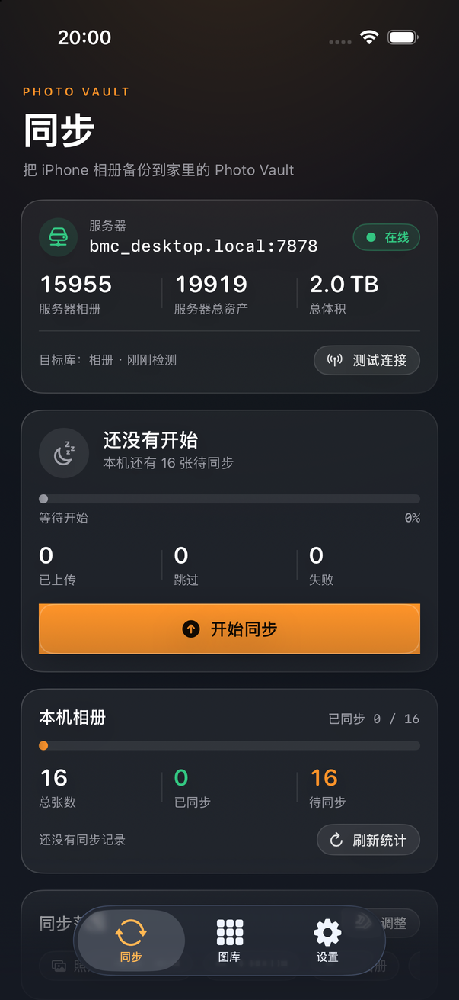

# Photo Vault · iOS 同步 App

iPhone 上唯一要做的事：**把系统相册里的照片/视频原件推到家里的 Photo Vault**。
不做双端删除同步、不做云端上传——这是有意为之（见文末「设计取舍」）。

- 目标系统：iOS 17+（iPhone），SwiftUI + PhotoKit，零第三方依赖
- 服务器：`http://bmc_desktop:7878`（局域网；换地址改 App 内设置）
- 服务端契约：根 README 的 [「iOS App 接入（相册同步）」](../README.md#ios-app-接入相册同步) 一节



（截图是模拟器上连真实服务器的状态；同步页不含私人照片，图库页截图不放进仓库。）

---

## 30 秒跑起来（模拟器）

```bash
cd ios
make run                 # 生成工程 → 编译 → 装进模拟器 → 启动
```

`make run` 默认用 iPhone 17 Pro；换机型：`make run SIM="iPhone 17 Pro Max"`。

首次启动后：

1. App 默认地址是 `http://bmc_desktop:7878`，点「连接测试」→ 显示在线 + 服务器张数；
2. 触发系统相册授权，选「允许完全访问」（部分授权也能用，但只有可见照片会同步）；
3. 点「开始同步」。

模拟器相册里默认只有几张示例图，可以用 QA 的播种脚本塞测试素材：

```bash
python3 tools/seed_simulator_media.py          # 生成 iostest-* 素材并 addmedia 进模拟器
```

## 装到真机

工程不带签名身份，用 Xcode 打开后选自己的 Team 即可（免费 Apple ID 也行）：

```bash
cd ios
make open                                       # 打开 PhotoVaultSync.xcodeproj
# Xcode → target PhotoVaultSync → Signing & Capabilities → Team 选自己的账号
```

或者命令行：

```bash
xcodebuild -project PhotoVaultSync.xcodeproj -scheme PhotoVaultSync \
  -destination 'platform=iOS,id=<你的设备 UDID>' \
  DEVELOPMENT_TEAM=<你的 TeamID> -allowProvisioningUpdates build
```

真机第一次连局域网时，iOS 会弹「**允许「相册同步」查找并连接本地网络设备？**」，
必须点允许，否则所有请求都会失败（设置 → 隐私与安全性 → 本地网络 里可以补开）。
`Info.plist` 已配好：

| 键 | 作用 |
|---|---|
| `NSAppTransportSecurity.NSAllowsLocalNetworking` | 放行局域网明文 HTTP（不是 `NSAllowsArbitraryLoads`） |
| `NSLocalNetworkUsageDescription` + `NSBonjourServices: _http._tcp` | 本地网络权限弹窗的说明与发现 |
| `NSPhotoLibraryUsageDescription` | 相册读取授权 |
| `UIBackgroundModes: fetch, processing` + `BGTaskSchedulerPermittedIdentifiers` | 后台续传 |

> 免费开发者账号的 App 7 天过期；长期使用建议用自己的付费开发者账号签名。

---

## 它能做什么

**同步（主界面）**

- 扫描本机相册（照片 / 视频 / Live Photo，可按「只同步某日期之后」过滤）；
- 服务器索引对账：先把服务器上已有的文件（`/api/assets` 全量索引）跟本机对一遍，
  已经在库里的直接跳过，**不会因为重装 App 就把几万张照片重新上传一遍**；
- 导出原件（HEIC/JPG/MOV…），按服务端 `/api/upload` 契约流式上传；
- Live Photo 自动配对：`PHAsset` 的静帧与 `.pairedVideo` 用同一个 `batch`、同一个 stem
  （`IMG_0001.HEIC` + `IMG_0001.MOV`）**先静帧后动态**上传，服务端合成一条 `live_photo`；
- 增量：按 `PHAsset.modificationDate` 记账（`SyncLedger.json`），已同步且没改过的不再碰；
- 断点/重试：单条失败不影响整批，失败队列可一键重试；网络错误自动退避重试；
- 后台上传：`URLSession` 后台会话 + `BGProcessingTask`，切到后台/锁屏继续传；
- 实时进度：已上传/总数、跳过、失败、字节、速度、ETA、当前文件名。

**图库（第二 Tab）**

浏览服务器上的相册：分页网格、缩略图、按天分组、点开看大图与 EXIF 摘要。
这一页是只读的——手机上不做删除、改标签这类操作，避免误触毁库。

**设置**

服务器地址与连接测试、目标库（相册 / 素材库）、同步范围与并发、相册权限管理、
诊断日志（出问题时可以直接看到每个请求）。

---

## 工程结构

```
ios/
├── project.yml                    # XcodeGen 工程描述（仓库不提交 .xcodeproj）
├── Makefile                       # make project/build/test/run/open/icon
├── PhotoVaultSync/
│   ├── App/
│   │   ├── PhotoVaultSyncApp.swift   # @main，挂 AppModel / 环境对象
│   │   └── AppModel.swift            # 状态根：settings + engine + 服务器健康
│   ├── Core/                      # 不依赖 PhotoKit/UI 的纯逻辑（可单测）
│   │   ├── Models.swift           # 服务端 DTO / SyncState / SyncOptions / 格式化
│   │   ├── APIClient.swift        # 只读接口 + 静态资源 URL + 错误映射
│   │   ├── ServerEndpoint.swift   # 地址规范化、.local 候选、局域网判定
│   │   ├── SettingsStore.swift    # 持久化设置 + 连接测试
│   │   ├── AppLog.swift           # 环形日志缓冲（设置页可看）
│   │   └── Theme.swift            # 视觉常量
│   ├── Sync/                      # 同步内核
│   │   ├── SyncEngine.swift       # 对 UI 暴露的引擎（状态机、并发 worker、控制）
│   │   ├── PhotoLibrary.swift     # PhotoKit 唯一出口：授权/枚举/资源描述/导出原件
│   │   ├── SyncPlanner.swift      # 纯规划：原件资源选择、文件名、Live Photo 配对顺序
│   │   ├── ServerIndex.swift      # 服务器已有文件索引 + 匹配（basename/尺寸/日期/时长）
│   │   ├── SyncLedger.swift       # 增量账本（JSON 原子写）
│   │   ├── UploadClient.swift     # 后台 URLSession 上传（uploadTask(fromFile:)）
│   │   ├── RetryPolicy.swift      # 失败分类 + 退避重试
│   │   ├── BackgroundSync.swift   # BGTaskScheduler 注册 / 排队 / 执行
│   │   └── BackgroundSupport.swift# AppDelegate：后台会话事件 + 后台任务接线
│   ├── UI/                        # 三 Tab：同步 / 图库 / 设置
│   │   ├── SyncView.swift         # 服务器卡、同步状态机、本机统计、最近动态
│   │   ├── LibraryView.swift      # 服务器图库网格（分页/筛选/下拉刷新）
│   │   ├── AssetDetailView.swift  # 大图 + 元数据 + 标签
│   │   ├── SettingsView.swift     # 地址/目标库/同步选项/权限/诊断日志
│   │   ├── RemoteLibraryModel.swift, RemoteImageStore.swift, DesignSystem.swift
│   └── Resources/Assets.xcassets  # AppIcon（tools/make_app_icon.py 生成）
├── Tests/PhotoVaultSyncTests/     # 单元测试（Core + Sync 纯逻辑）
├── tools/
│   ├── regen.sh                   # 带锁的 xcodegen（多人/多 agent 并发时用）
│   ├── make_app_icon.py           # 代码画 App 图标
│   ├── seed_simulator_media.py    # 往模拟器相册塞 iostest-* 测试素材
│   └── cleanup_test_assets.py     # 清理服务器上的 iostest-* 资产
└── qa/                            # 验证报告与截图（REPORT.md）
```

### 同步流水线

```
PhotoKit 授权 ─▶ 枚举 PHAsset（过滤选项）
                    │
                    ├─▶ SyncLedger：已同步且未修改？跳过
                    ├─▶ RemoteIndex：服务器上已有？跳过（文件名+尺寸+日期匹配）
                    ▼
              AssetExporter：PHAssetResourceManager → Caches/Uploads/xxx
                    ▼
              UploadClient：POST /api/upload?name=&library=&batch=&taken=
                    ▼
              SyncLedger 记账（server asset id / duplicate / error）
```

Live Photo 的两条资源串行且同 `batch`：

```
IMG_0001.HEIC ──▶ /api/upload?name=IMG_0001.HEIC&batch=<uuid>   → asset(A, kind=photo)
IMG_0001.MOV  ──▶ /api/upload?name=IMG_0001.MOV &batch=<uuid>   → asset(A, kind=live_photo)
```

顺序反了会变成两条独立资产（服务端只能按「先静帧」认出配对），为此刻意在导出阶段就固定顺序。

**taken 拍摄时间**：每个上传请求都带上 `PHAsset.creationDate`（ISO8601 UTC）。
文件本身有内嵌时间（EXIF / 容器标签）时服务端以内嵌为准、`taken` 被忽略；
没有内嵌时间的资产（聊天保存图、截图重存、无 EXIF 渲染图）用它，日期才不会
在图库里显示成"上传那一刻"。

### 地址解析为什么单独一层

iPhone 上最容易卡住的不是上传，是**解析不到 `bmc_desktop`**：

- 用户可能只填 `bmc_desktop:7878`（没 scheme）→ 必须补 `http://`，否则 URLSession 报
  `unsupported URL`；
- 单段主机名在 iOS 上不保证能解析（macOS 能，iPhone 有时只认 mDNS）→ 连接测试会依次尝试
  `bmc_desktop` 和 `bmc_desktop.local`，成功的那条存成 `effectiveBase`；
- 失败时的报错会区分「解析不到」（建议换 IP）和「连不上」（提示检查本地网络权限）。

实测：模拟器（iOS 26.2）能直接解析 `bmc_desktop`；真机如果不行，`.local` 候选会兜住。

---

## 验证

```bash
cd ios
make test                                   # 单元测试：79 个（Core 26 + Sync 53 纯逻辑）
cat qa/REPORT.md                            # 端到端验证报告（真实服务器，测试资产已清理）
```

单测不依赖相册授权：`PhotoLibraryProviding` / `UploadTransferring` 都是协议，规划/账本/索引匹配/
重试/引擎状态机用假实现跑（含「第二轮增量 0 上传」「只传 Live Photo 静帧」「4xx 不重试」等场景）。

### DEBUG 启动参数（自动化验证用，Release 包里不存在）

```bash
# 自动跑一轮同步，并把起始日期/服务器地址临时覆盖掉（不改用户设置）
xcrun simctl launch <udid> com.photovault.ios \
  -autostartSync \
  -syncFromDateEpoch 1793462400 \
  -syncBaseURL http://127.0.0.1:1/
```

- `-autostartSync`：冷启动后自动开始一轮（用来抓同步中界面/无人工点按跑 e2e）
- `-syncFromDateEpoch <秒>`：只同步这个时间之后的资产（用 Unix 秒，避免时区解析）
- `-syncBaseURL <url>`：临时指向别的服务器（配合上面的 `127.0.0.1:1` 做「必失败」dry-run）

QA 验证覆盖：服务端契约（imported / duplicate / Live Photo 配对）、模拟器端到端同步、
二次同步幂等、暂停/继续/失败重试、图库 WebP 缩略图、错误地址提示、测试资产清理。

---

## 排错

| 现象 | 原因 / 处理 |
|---|---|
| 连接测试失败，提示「本地网络」 | 系统权限没给：设置 → 隐私与安全性 → 本地网络 → 打开「相册同步」 |
| 解析不到 `bmc_desktop` | 直接填局域网 IP，如 `192.168.31.115:7878`；确认手机和电脑同一 Wi-Fi |
| 电脑休眠后同步不动 | 服务器在另一台机器上，唤醒后 App 内点「连接测试」再继续 |
| 一直显示「跳过」 | 服务器索引匹配到了（说明库里已有）；想强制重传就关掉「跳过服务器已有」 |
| 大视频传不完 | 切后台会续传；iPhone 空间不足时导出会失败，先清出空间 |
| 重复上传（想验证去重） | 服务端按 sha256 去重，重复内容返回 `duplicate`，不会产生副本 |
| 装了但同步 0 张 | 相册是「部分授权」：设置页 → 管理可访问照片 → 全选 |

---

## 设计取舍

- **只推不拉、不做双向删除**：手机删照片不代表服务器要删（相册是「保险库」，删是网页端
  的显式操作）。这样最坏情况是服务器多一张，而不是少一张。
- **不传 iCloud 上的占位符**：`allowICloudDownload` 关掉时，只在 iCloud、本机没下载的原件
  会跳过，避免把低清占位图当原件传上去。
- **服务器索引对账放在本机账本之前**：重装 App（账本丢了）也能避免全量重传；代价是要翻
  `/api/assets` 全量索引（16k 张约 54 个请求，局域网几秒）。
- **不做后台静默全量同步**：iOS 后台执行时间由系统决定，首次同步几万张建议前台插着电跑；
  后台任务只用于把已排队的批次传完。
- **不用第三方库**：SwiftUI + PhotoKit + URLSession 够用，P0 阶段少一个依赖少一个坑。
- **WebP 缩略图直接用**：iOS 14 起 ImageIO 内置 WebP 解码（iOS 26.2 实测 `UIImage(data:)` 512×384
  正常），所以 App 直接吃 `/thumbs/{sha}.webp`，不额外要服务端出 JPEG；代码里仍保留运行时回退
  `/preview/{id}`，以防将来系统行为变化。
- **已知偏差：服务器 `/api/stats` 的 bytes 不含 Live Photo 的动态视频**（只统计 role=original/raw），
  所以 App 的「已上传字节」会比服务器统计多出 MOV 那部分，属预期，不是 bug。
